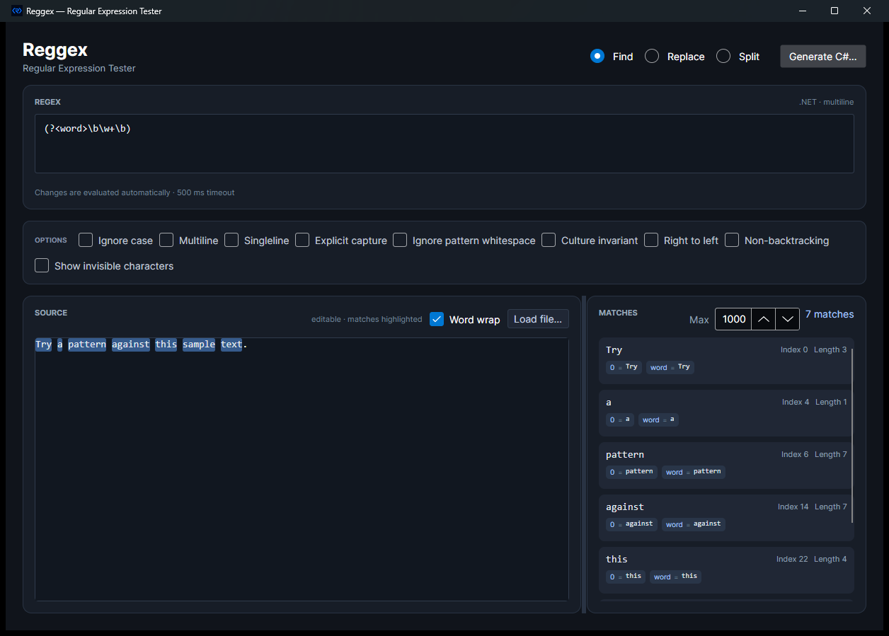

# Reggex

**A desktop app for building and testing .NET regular expressions.** Edit a pattern and sample text side by side, inspect matches and capture groups, and see matching text highlighted in the editable source editor.



## Features

- **Find, Replace, and Split** evaluate patterns against editable sample text, preview replacements, and inspect split segments.
- **Match details and highlighting** show match/group positions, lengths, and repeated captures. Select a match to emphasize it and move the source editor to its position; zero-length matches have position markers.
- **Regex options** include Ignore case, Multiline, Singleline, Explicit capture, Ignore pattern whitespace, Culture invariant, Right to left, and Non-backtracking.
- **Invisible characters** can be shown with visible markers for spaces, tabs, line endings, and control characters.
- **C# code generation** supports instance/static examples and `[GeneratedRegex]`.
- **Keyboard shortcuts**: `Ctrl+O` loads a source file, `Ctrl+G` opens code generation, `Ctrl+1/2/3` switches modes, and `Ctrl+Enter` or `F5` reevaluates.
- **Immediate feedback** updates as you edit, reports invalid patterns, and limits regex execution to 500 ms.

Reggex uses .NET's `System.Text.RegularExpressions` engine. Pattern syntax and behavior follow .NET regular expressions.

## Download

Download the latest self-contained build for Windows x64, Linux x64, or macOS ARM64 from [GitHub Releases](https://github.com/beppel/Reggex/releases/latest). Packages include the .NET runtime; Linux still requires the native libraries needed by the desktop environment.

- Windows x64: `Reggex-win-x64.zip`
- Linux x64: `Reggex-linux-x64.tar.gz`
- macOS ARM64: `Reggex-osx-arm64.tar.gz`

Each release also includes `SHA256SUMS.txt` to verify the downloads.

## Run from source

Requires the .NET 10 SDK. From the repository root:

```sh
dotnet run --project src/Reggex.Desktop
```

## Test

Run both test suites with:

```sh
dotnet test src/Reggex.Core.Tests
dotnet test src/Reggex.Desktop.Tests
```

## Project structure

- `src/Reggex.Core` contains the regex engine, request and result models, and execution behavior. It has no UI dependency.
- `src/Reggex.Desktop` contains the Avalonia desktop interface and its MVVM presentation logic.
- `src/Reggex.Core.Tests` contains unit tests for Core behavior.
- `src/Reggex.Desktop.Tests` contains tests for desktop presentation logic and code generation.
- `documentation` contains the architecture notes, screenshot, and project roadmap.

The UI is built with Avalonia and CommunityToolkit.Mvvm. Cross-platform runtime validation is still in progress; see [the roadmap](documentation/roadmap.md) for current support status.
